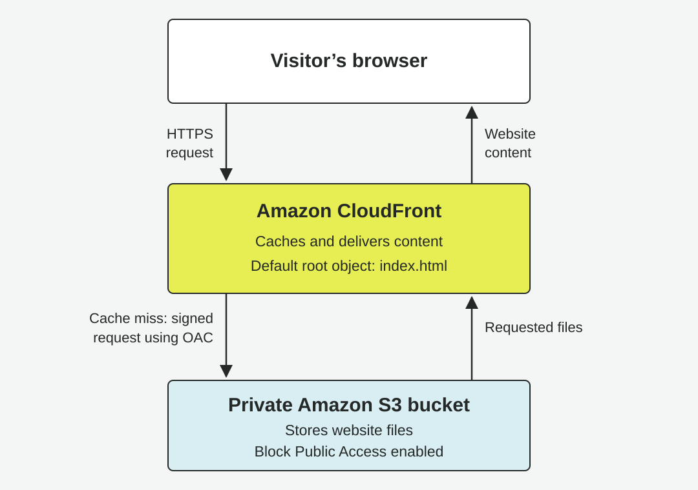

# Real Money Washers

A static website built with HTML, CSS, and JavaScript, hosted on AWS.

[Live website](https://d1htlmh1ce297i.cloudfront.net/) · [Assessment submission](https://d1htlmh1ce297i.cloudfront.net/submission.html)

## Architecture

Visitors reach the website through Amazon CloudFront. It serves cached content when available; on a cache miss, it requests the files from a private S3 bucket using Origin Access Control (OAC).



At the bucket root, the generated HTML files sit beside the assets. CloudFront's default root object is `index.html`, so opening the base distribution URL loads the homepage.

## AWS services used

The deployment uses two AWS services:

| Service | Role in this project |
| --- | --- |
| Amazon S3 | Stores the website files in a private bucket in Ohio (`us-east-2`). |
| Amazon CloudFront | Provides the public website endpoint and caches content at edge locations. |

## Security configuration

S3 Block Public Access is enabled, including all four individual settings. The CloudFront origin uses OAC to access the bucket.

The bucket policy grants the `cloudfront.amazonaws.com` service principal permission to read objects with `s3:GetObject`. An `AWS:SourceArn` condition restricts that permission to the designated CloudFront distribution. The policy grants object reads; it does not grant uploads or deletions.

The public website uses the HTTPS CloudFront URL. Screenshots of the bucket permissions, bucket policy, and CloudFront origin settings are included on the submission page.

## Implementation decisions

The site needs no application server. Plain HTML, CSS, and JavaScript suit this deployment because S3 can store the finished files and CloudFront can deliver them directly, while the browser handles the interactions, including a contact form that keeps its data on the client.

During the build, a small Node.js script combines page fragments with the shared header and footer, then copies the assets into `dist/`. No package installation is needed. With shared templates, a navigation or footer change carries through to every page on the next build.

Images and fonts are stored locally with the source and included in the build. Links point directly to each page's HTML file, such as `about.html` or `submission.html`.

Deployment is manual: build locally, upload the contents of `dist/` to S3, then invalidate CloudFront's cache when replacing existing files.

## Challenges and resolutions

Two deployment details needed attention.

Opening the base CloudFront URL did not load the `index.html` file at the bucket root. Setting the distribution's default root object to `index.html` fixed the landing page URL. The filename no longer had to be entered.

Updating S3 also raised a separate caching issue. CloudFront can continue serving older cached files after their replacements have been uploaded. An invalidation for `/*` clears the cached pages and assets so subsequent requests can retrieve the current files from S3. The deployment steps below include this cache refresh. A browser may still retain its own copies, so a private window is useful when checking an update.

## Run locally

Use Node.js 20 or later. Run commands from the `real-money-washers` project root:

```sh
npm run dev
```

Open http://localhost:4173. The submission page is at http://localhost:4173/submission.html. Stop the server with Ctrl+C.

## Build and deployment

Generate the deployable files:

```sh
npm run build
```

Upload the contents of `dist/` to the S3 bucket root. The HTML files and `assets/` directory should sit side by side; do not upload them inside an extra `dist/` directory.

Set CloudFront's default root object to `index.html`, without a leading slash. After uploading an update, open the distribution's **Invalidations** tab, choose **Create invalidation**, and enter `/*`. Wait for the status to become **Completed**, then check the public website.

## Editing the project

Edit the source files, then rebuild. Changes made directly in `dist/` will be replaced by the next build.

| Location | Contents |
| --- | --- |
| `src/pages/` | Page fragments, including the submission page. |
| `src/header.html`, `src/footer.html` | Shared navigation and footer. |
| `src/styles.css`, `src/pages.css`, `src/submission.css` | Shared and page-specific styles. |
| `src/main.js`, `src/contact.js`, `src/submission.js`, `src/water.js` | Navigation, form behaviour, screenshot viewer, and water effect. |
| `public/assets/` | Images, icons, fonts, and infrastructure evidence. |
| `scripts/` | Static build and local server scripts. |
